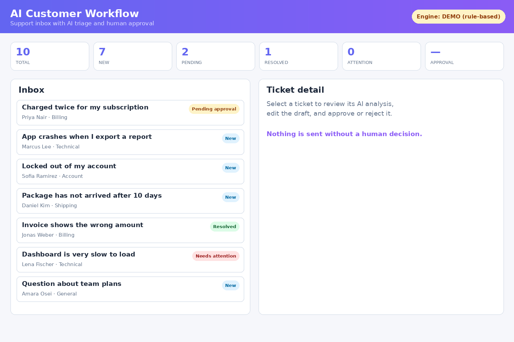
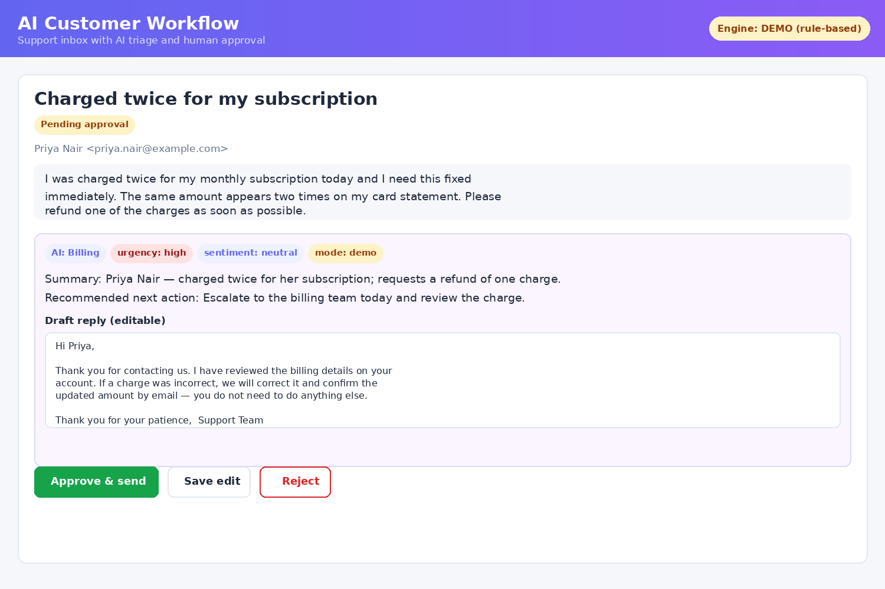
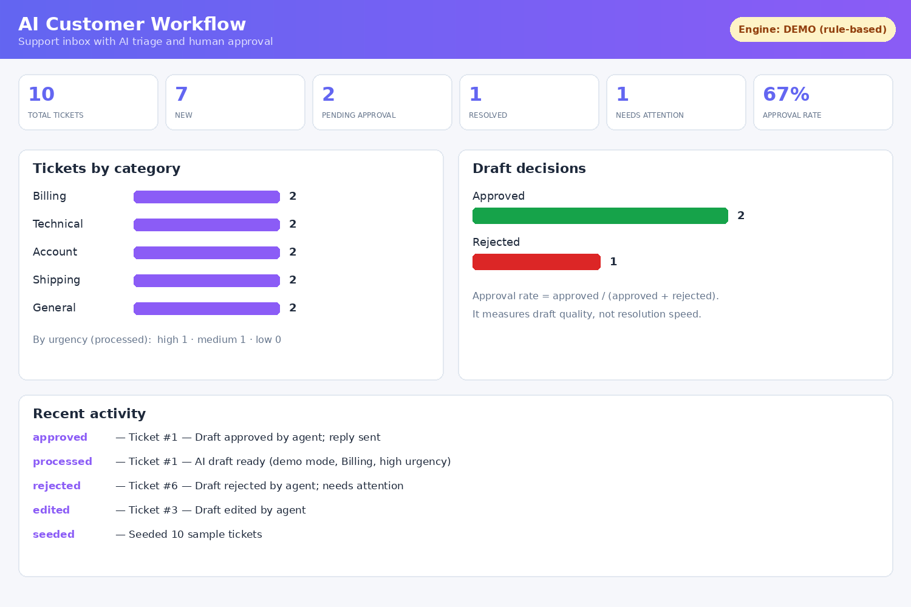

# AI Customer Workflow Automation Platform

A customer-support workflow automation platform: tickets are triaged by an AI pipeline (category, urgency, sentiment, summary, draft reply, recommended next action) and every draft waits in a **human approval queue** — nothing is sent until a person approves, edits, or rejects it.



*UI previews (renderings of the app's screens); real screenshots welcome after first run.*





## Features

- **Ticket inbox** — seeded with 10 sample tickets across Billing, Technical, Account, Shipping, and General, with status filtering; new tickets can be created through the API.
- **AI pipeline per ticket** — classifies category and urgency, detects sentiment, writes a one-line summary, drafts a reply, and recommends a concrete next action.
- **Human-in-the-loop approval** — drafts land in a *Pending approval* queue. Approve sends the reply and resolves the ticket; edit keeps the ticket in the queue with your wording; reject flags it *Needs attention*.
- **Dashboard** — counts by status, category, and urgency, a draft approval rate (approved ÷ decided, a measure of draft quality), and a recent-activity feed.
- **Two engines, honestly labelled** — with `OPENAI_API_KEY` set, drafts come from the OpenAI chat API (`mode: "llm"`). Without a key, a built-in deterministic rule-based engine runs instead and every response, badge, and banner says `mode: "demo"`. Demo output is never presented as model output.

## How it works

1. A ticket arrives with status **New**.
2. `POST /api/tickets/{id}/process` runs the pipeline and stores its analysis on the ticket. Status becomes **Pending approval**.
3. A human reviews the draft in the UI (or API):
   - **Approve** → status **Resolved**, decision logged.
   - **Edit** → draft updated, ticket stays **Pending approval**.
   - **Reject** → status **Needs attention**, decision logged.
4. Every step is written to an activity log, which is what the dashboard reads.

State transitions are enforced by the API: you cannot approve a ticket that has not been processed, and editing never approves.

## Tech stack

| Layer | Technology |
| --- | --- |
| Backend | Python 3.11+, FastAPI, Pydantic |
| Storage | SQLite via the Python standard library (no ORM) |
| LLM | OpenAI chat completions via `httpx` (optional; demo engine otherwise) |
| Frontend | Single-page vanilla HTML/CSS/JS served by FastAPI |
| Tests | pytest + FastAPI TestClient |

## Run it

```bash
cd ai-customer-workflow
python3 -m venv .venv
source .venv/bin/activate
pip install -r requirements.txt
uvicorn app.main:app --port 8000
```

Open http://localhost:8000 — the inbox is seeded automatically on first start.

For live LLM drafts instead of demo mode:

```bash
export OPENAI_API_KEY=sk-...        # optional; OPENAI_MODEL defaults to gpt-4o-mini
uvicorn app.main:app --port 8000
```

If the API call ever fails, the app falls back to the demo engine and labels the result `demo` — it never silently passes rule-based output off as a model draft.

## Run the tests

```bash
python -m pytest
```

14 tests: the demo pipeline's classification/urgency/sentiment behaviour, the full API approval flow (process → approve, edit → reject, approve-before-process is a 400), ticket creation, and the stats shape including the approval rate.

## API

| Method | Route | Description |
| --- | --- | --- |
| GET | `/api/tickets` | List tickets; optional `?status=` and `?category=` filters |
| POST | `/api/tickets` | Create a ticket (201) |
| GET | `/api/tickets/{id}` | One ticket with its AI analysis |
| POST | `/api/tickets/{id}/process` | Run the AI pipeline → *Pending approval* |
| POST | `/api/tickets/{id}/approve` | Approve the draft → *Resolved* |
| POST | `/api/tickets/{id}/edit` | Replace the draft text; stays *Pending approval* |
| POST | `/api/tickets/{id}/reject` | Reject the draft → *Needs attention* |
| GET | `/api/stats` | Dashboard counts, approval rate, recent activity, engine `mode` |

## Project structure

| Path | Contents |
| --- | --- |
| `app/main.py` | FastAPI app and routes; enforces the workflow's state transitions |
| `app/pipeline.py` | The two engines (LLM + demo) behind one `PipelineResult` interface |
| `app/models.py` | SQLite schema and helpers (tickets + activity events) |
| `app/seed.py` | Ten sample tickets; seeded once, only into an empty database |
| `static/` | The single-page UI (`index.html`, `app.js`, `styles.css`) |
| `tests/` | Pipeline unit tests and API happy-path tests |
| `screenshots/` | UI preview renderings |

## Design notes

- **Why human-in-the-loop:** an LLM draft is a suggestion, not a decision. The approval queue is the product, not a safety afterthought — it gives the business a review point, an audit trail (the activity log), and a quality metric (approval rate) for the drafts themselves.
- **Why a demo-mode fallback:** the project must be runnable and testable by anyone, with no API key and no bill. A deterministic rule-based engine makes behaviour reproducible in tests, and the strict `mode` labelling keeps the demo honest — the UI shows a banner whenever drafts are not coming from a model.
- **Why SQLite and no ORM:** at this scale, plain SQL in one file is easier to read, debug, and explain than an ORM layer. The data layer is isolated in `models.py`, so swapping in Postgres later touches one file.
- **What a production version would add:** a real task queue (Celery/RQ) so processing is asynchronous, authentication and per-agent permissions, email/CRM integrations (the approve step would actually send via the mail provider), streaming model responses, per-category prompt templates with evaluation sets, and rate limiting.

## About

Tejal Patel — full-stack software engineer, M.S. Computer Science, Seattle University (2026).
[LinkedIn](https://www.linkedin.com/in/tejalppatel/) ·
[GitHub](https://github.com/Tejalpatel2099) ·
[Portfolio](https://portfolio-self-xi-37.vercel.app/)
